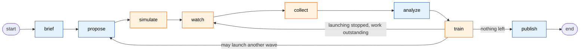

# Online steering with LangGraph on Dragon

A LangGraph agent runs an MPI simulation campaign on an HPC cluster: it
launches miniAMR runs, watches them while they compute, stops the ones going
nowhere, trains a small model on the results, and uses that model and an LLM
to choose the next runs. Dragon supplies what LangGraph cannot: placing nodes
on chosen machines, one scheduler for MPI jobs and Python tasks, a shared
in-memory store that keeps hundreds of megabytes on the machine that produced
them, and an LLM that runs inside the allocation.

This directory is self-contained. It needs the Dragon runtime and a miniAMR
clone with the hook in [miniamr/](miniamr) applied; nothing else.

---

## The loop

The campaign is an active-learning loop. The question it answers is: given
two settings of a moving object (its speed and its size), how much does the
adaptive mesh have to refine? Each real answer costs one MPI simulation, so
the loop tries to ask for as few as possible.

It works like this. `brief` fixes the search box and the budget. `propose`
picks four settings to try: at random on the first wave, and afterwards by
asking the three ensemble surrogates where they disagree most, since
disagreement marks the settings nobody has measured yet. `simulate` launches
those four as MPI jobs and does not wait for them. `watch` reads what the
running jobs publish about themselves every few timesteps and cancels any
that are heading for a known failure: a per-rank block count approaching the
cap where miniAMR would abort, a checksum that has gone non-finite, or a run
that has been out too long. `collect` turns each finished job into a single
number, the block count of its final mesh, and appends it to the training
set. `analyze` lets an LLM look at the recent results through a few read-only
tools and, if it sees a pattern, steer the region of dials that the next
`propose` samples from. `train` fits the three surrogates on the labels
gathered so far and promotes them as the current ensemble. Then the loop goes
round again, and each pass the ensemble has more data and the next four
settings are better chosen. When the budget is spent or the ensemble is
accurate enough, the loop stops launching, waits for what is still running,
and `publish` saves the model.

What Dragon adds, and by what means:

- **Placement.** `DragonExecutor.launch_hosts` with a `Policy(HOST_NAME)` per
  AgentHost puts the thinker and the worker on different machines, and
  `Batch.job` with a `Policy` puts each MPI run on a machine of its own.
- **Waves overlap.** `Batch.job`, `Batch.process`, and `Batch.function` all
  return a task handle at once; the worker polls with `Task.get(block=False)`
  and never waits. So wave 4 launches while wave 2's runs and wave 3's model
  fits are still computing.
- **Automatic placement for the fits.** Each ensemble member is trained by a
  plain Python function handed to `Batch.function` with no `Policy`. Batch
  finds a machine with room and runs it there, so the three fits land wherever
  the MPI runs are not, with no host list in the code.
- **Mid-run steering.** The solver's C hook writes small telemetry into a
  DDict every few timesteps; `watch` reads it from another machine while the
  ranks are still stepping and stops a run with `Task.cancel`, all before the
  job ends.
- **Data locality.** Each rank writes its field snapshot, hundreds of MB,
  through a DDict handle pinned to its own machine's manager. Nothing ever
  reads that field from elsewhere: `Batch.process` places the reader on the
  same machine, it reads through `ddict.manager(local_manager)`, and only a
  few hundred bytes of summary cross to the campaign DDict.
- **Shared state without a database.** One campaign DDict holds the training
  set, the promoted ensemble, and every run's record; both AgentHosts and
  every placed process read and write it directly.
- **LLM in the allocation.** vLLM runs as Dragon processes; the thinker
  reaches it through a Queue with `get_llm(queue).chat`. Its tools read the
  campaign DDict. No API key, no data leaves the cluster.

Eight graph nodes, one conditional edge. It is an ordinary LangGraph
`StateGraph`: plain functions, fixed edges, small state.



Blue nodes run on the **thinker** AgentHost, orange on the **worker**. Each is
one long-lived Dragon process pinned to its own machine.

| node | host | LLM | in one line |
|---|---|---|---|
| `brief` | thinker | yes | Turn the English request into numbers: which inputs to sweep, how many runs, what error to aim for. |
| `propose` | thinker | no | Pick the next four input settings to simulate. |
| `simulate` | worker | no | Launch those four as MPI jobs, one per machine, and return at once. |
| `watch` | worker | no | Read what the running jobs publish, and stop any that are going wrong. |
| `collect` | worker | no | Turn each finished job into one number for the training set. |
| `analyze` | thinker | yes | Let the LLM look at recent results with tools and suggest where to search next. |
| `train` | worker | no | Fit a small model on a frozen copy of the training set. |
| `publish` | thinker | no | Save the model and a card of measured facts. |

One trip around `propose → ... → train` is a **wave**. The loop keeps going
while there is budget to launch more runs; then it drains what is still
running; then it publishes.

## Five words the output uses

Now that you have seen the loop, the vocabulary in every printed line and every
other document:

| word | meaning |
|---|---|
| **dials** | the two inputs of one simulation: the moving object's speed and size. The campaign's job is to learn how much the mesh refines as a function of them. On the first wave `propose` picks four pairs at random. Once a model exists it draws 400 candidate pairs, scores each by how much the three ensemble members disagree about it, keeps the three most disputed, and adds one more at random so the search never gets stuck in a corner. |
| **run** | one miniAMR simulation with one pair of dials, launched by `simulate`: 8 MPI ranks on one machine, about 200 timesteps. |
| **wave** | one trip around the loop above. Each wave `propose` selects four pairs of dials and `simulate` launches four runs, one per pair, on four different machines. A run may still be computing several waves after it was launched; nothing waits for it. |
| **run id** | `w<wave>-p<index>`. `w3-p0` is the first of the four runs launched in wave 3. Every printed line about a run carries its id, so you can follow one run from launch to label. |
| **node1, node2, ...** | the machines in the allocation. The thinker AgentHost is pinned to one, the worker AgentHost to another, and runs are dealt out over all of them. Real output shows your site's hostnames. |

## What Dragon does here, in five lines of output

Each of these is one line the campaign prints. [OUTPUT.md](OUTPUT.md) explains
how to read all of them.

| Dragon lets the graph... | and the terminal shows |
|---|---|
| **Put each agent on its own machine**, and MPI jobs on the rest | `[startup] thinker: node1` / `[startup] worker: node2` / `[simulate] w3-p0: submitted 8 ranks on node4` |
| **Read a job's own numbers while it runs, and stop it** | `[watch] w3-p2 t60 live: blocks/rank=5412 ...; read from the mesh DDict while 8 ranks compute` → `[watch] cancel requested: w3-p2: per-rank blocks 5412 >= 5400` |
| **Keep the big data where it was written**; send a small process to it | `[collect] w3-p0: read 629145600 bytes on node4 same_node=True; 331 bytes crossed to the campaign DDict` |
| **Launch the next wave while the last one is still computing**, fits included | `[simulate] still running from earlier waves: solvers=6 live_readers=1 reducers=1 fits=3` |
| **Call an LLM that lives in the allocation**, with tools that read the shared store | `[analyze] decision: steer_region=[[0.004, 0.007], [0.4, 0.8]]` → `[propose] ... region=steered by analyze` |

## Quickstart

```bash
# 1. Build miniAMR with the hook (once). Full steps in BUILD.md.
git clone https://github.com/Mantevo/miniAMR.git miniAMR-live
cp miniamr/miniamr_live.{c,h} miniAMR-live/ref/     # then the six edits in BUILD.md
(cd miniAMR-live/ref && make)

# 2. Prove the hook writes, inside an allocation.
dragon probe_live.py --bin miniAMR-live/ref/miniAMR-live.x

# 3. Run the campaign. Needs at least two machines; do not pass -s.
dragon campaign.py --bin miniAMR-live/ref/miniAMR-live.x
dragon campaign.py --bin miniAMR-live/ref/miniAMR-live.x --llm <model-path> --gpus 1
```

Then read the output with [OUTPUT.md](OUTPUT.md) open.

## The files

Two files at the top, four folders below. Each folder answers one question and
has a one-paragraph `__init__.py` saying what its layer is for. Dependencies
point one way: `campaign` calls into every folder; `execution` calls `data` and
`science`; `data` and `science` call nothing above them.

```
campaign.py            The graph. Eight node functions, next_step, build_graph, main.
                       Every Dragon call that carries a pitch is here or one call away,
                       marked with a comment starting "# Dragon:".
settings.py            Every tunable constant, brief validation, and the list of
                       campaign-DDict keys with who reads and writes each.

execution/             What Dragon does for the graph.
  launch.py              Resources: create and destroy the two DDicts, Batch, and
                         the optional vLLM Inference. The launcher owns all of them.
  clients.py             Process-local DDict clients (attach once, cache), the model
                         cache, Task polling without blocking, TrackedTask (cancel
                         with confirmation), the MPI job's ProcessTemplate.
  worker.py              WorkerRuntime: the one owner of every run, reader, reducer,
                         and fit on the worker host. Launches all Batch tasks.
                         fit_member, the function Batch runs for one ensemble member.
  steering.py            The watch window: read live telemetry, decide when to send a
                         reader, the pure rules that name a run to stop.

data/                  Where the hundreds of megabytes go.
  mesh.py                Reader for the four keys the C hook writes: byte layouts,
                         the raw pickler, local_view (the data-locality line),
                         summarize_snapshot, free_run. Documents every mesh key.
  reduce_worker.py       The three functions Batch places on the data's machine:
                         summarize_snapshot (mid-run), finalize_run (after), free_only.

science/               The science, and where to swap in yours.
  solver.py              miniAMR command line, the constants shared with C, the two
                         dials and their ranges.
  sampling.py            Which dials to run next, when to fit, when to stop.
  surrogate.py           The three-member Torch ensemble: train one member, assemble,
                         predict with disagreement.

llm/                   Where the LLM is, and what it may do.
  tools.py               The bounded ReAct loop (thought, act, observe) and its three read-only tools.
  prompts.py             The two prompts and their JSON schemas.

miniamr/               The C hook. Not miniAMR itself.
  miniamr_live.c         Writes telemetry and field snapshots into the mesh DDict from
                         inside the MPI job. Every function has a header comment.
  miniamr_live.h         Key layout, ordering rules, the six edits to wire it in.

probe_live.py          Standalone check that a built miniAMR-live.x writes what the
                       campaign expects. Run this before the campaign.

README.md              This file.
ARCHITECTURE.md        Processes, Batch tasks, DDict keys, every Dragon call.
NODES.md               What each node does and prints; what the numbers mean.
BUILD.md               Patching and building miniAMR, line by line.
OUTPUT.md              Running it, and reading the output line by line.
```

## How to read this example

In this order, stopping when you have what you need:

1. **This file.** The loop, the five words, then the five-line table: that
   table is the claim, and the rest of the documents are the evidence.
2. **[OUTPUT.md](OUTPUT.md).** Read it against a real run if you have one, or
   against the sample lines. Six sections, one per Dragon behaviour. This is
   the fastest way to see what the code does without reading the code.
3. **[ARCHITECTURE.md](ARCHITECTURE.md), the first three sections.** Which
   process runs what; the four kinds of Batch task; the diagram of every DDict
   read and write. After these you know where every byte goes.
4. **[campaign.py](campaign.py), top to bottom.** 350 lines. Every `# Dragon:`
   comment is a place where Dragon does something LangGraph cannot. The table
   "Where each Dragon call lives" in ARCHITECTURE.md links each one.
5. **[NODES.md](NODES.md)** when a node's behaviour or printed line is unclear.
6. **[execution/worker.py](execution/worker.py)** and
   **[data/reduce_worker.py](data/reduce_worker.py)** if you want to change
   how runs are tracked or reduced.
7. **[BUILD.md](BUILD.md)** only when you are ready to build.

If you want to swap in your own solver: change [science/solver.py](science/solver.py)
(command line and constants) and write a hook that produces the same four keys
as [miniamr/miniamr_live.h](miniamr/miniamr_live.h); change the reduction in
[data/mesh.py](data/mesh.py). The graph, the worker, and the steering rules do
not need to change.
